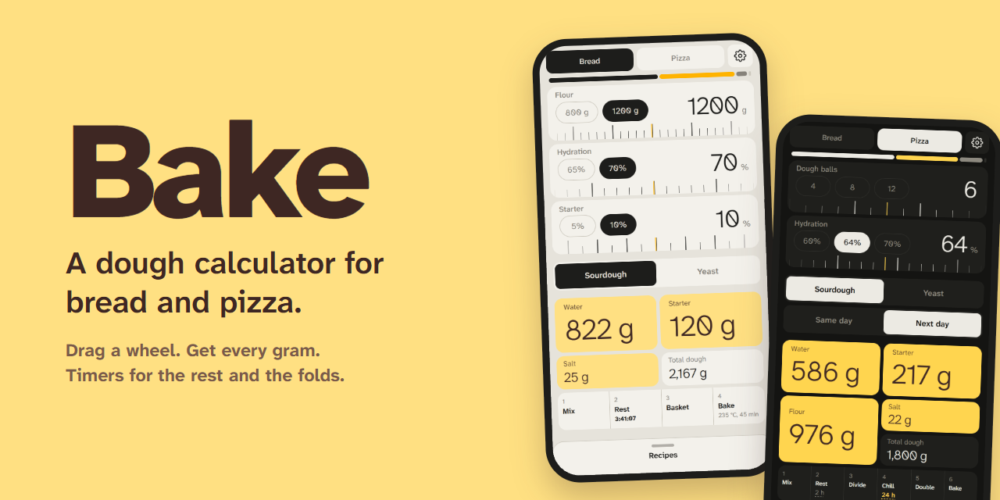
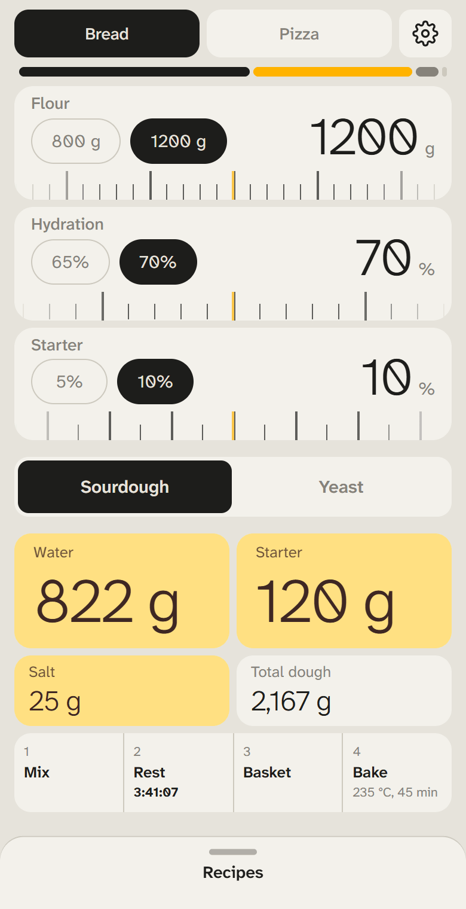
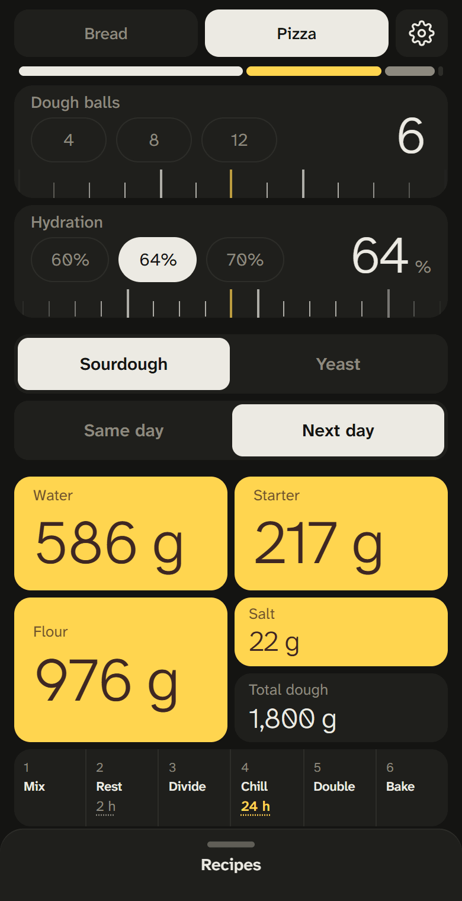
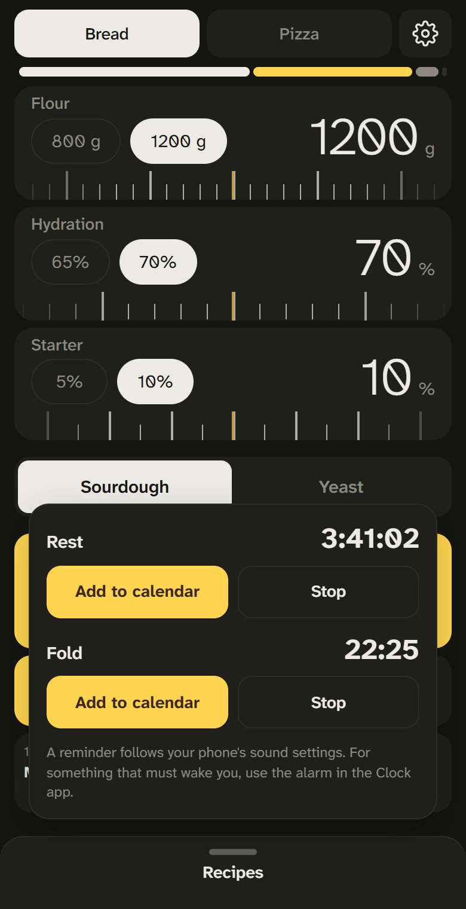
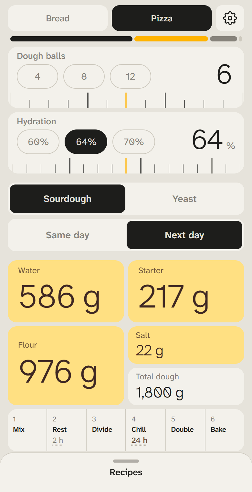

# Bake

A dough calculator for bread and pizza. Drag a wheel, tap a preset, and get every gram.

**Open it: [bake.juringari.com](https://bake.juringari.com)**



| Bread | Pizza |
| :---: | :---: |
|  |  |
|  |  |

## What it does

- **Bread** with sourdough or with yeast, **pizza** with sourdough or with instant yeast, same day or next day.
- **Wheels instead of fields.** Drag anywhere on a card to change a value, even starting on a preset button. The ruler follows your finger, with a small click on every step.
- **The amounts you pour and scoop come first:** water, the leavening, flour (for pizza) and salt are highlighted. Total dough is there, but quiet.
- **Timers for the long steps.** Tap the time of a step (the 4 h rest, the 24 h chill) to start a timer. Sourdough rests also get a 30 minute timer for the folds. A timer remembers when it ends, so it is right after you close the app. **Add to calendar** puts it in your phone's calendar with an alert at the end.
- **The bake step says what to set the oven to:** 235 °C for 45 minutes.
- **Presets** for the amounts you use most (800 g and 1200 g flour, 65 % and 70 % hydration, 5 % and 10 % starter).
- **Saved recipes** in a drawer at the bottom. Pull it up with your thumb, name the recipe, load it later.
- **English and Slovenščina**, light, dark or system theme, sound and haptics you can turn off. All in the settings at the top right.
- **One typeface:** [Atkinson Hyperlegible Next](https://github.com/googlefonts/atkinson-hyperlegible-next), made for being read easily. Licensed under the SIL Open Font License, a copy is in [`site/public/fonts`](site/public/fonts/OFL-AtkinsonHyperlegibleNext.txt).
- **Install it as an app** from the settings (top right, **Install app**): it gets its own icon, opens full screen and keeps working without a connection.
- Made to fit one phone screen. No account, no tracking.

## Add it to Home Assistant

You only need the address.

1. Open your dashboard and choose **Edit dashboard** (the pencil).
2. **Add card**, then pick the **Webpage** card.
3. For **URL**, enter `https://bake.juringari.com`
4. Save.

For a full-screen calculator, give the card its own view and set the view type to **Panel (1 card)**. On a phone, the Home Assistant app shows it like any other page.

If you use the YAML editor, the card is:

```yaml
type: iframe
url: https://bake.juringari.com
aspect_ratio: 170%
```

Inside Home Assistant the page loads from the internet, so the phone needs a connection when you open it. To use Bake without Home Assistant, open it in the browser and install it from the settings.

## Saved recipes and settings stay on your device

Bake keeps recipes, language and theme in the browser's own storage, so inside Home Assistant they stay in the Home Assistant app on that phone, and a regular browser has its own separate copy.

## About this repository

- [`site/`](site) is the Cloudflare Worker that serves Bake. Deploy notes are in [`site/README.md`](site/README.md).
- The original single-file version, a plain `baking.html` for a Home Assistant `/local/` page, now lives on the [`legacy`](../../tree/legacy) branch. The old GitHub Pages address forwards to Bake.
- The `/concepts/` page of the live site shows every design that was tried on the way, from the original to Material You, Apple glass, a Rams-style panel and a handful of unusual ones.

Made for [juringari.com](https://juringari.com).
